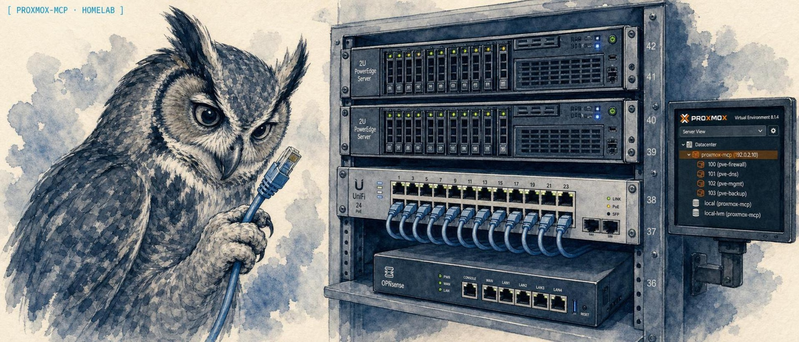
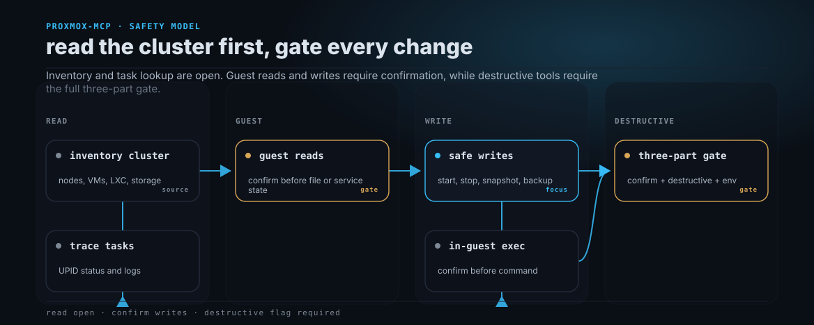

<p align="center">
  
</p>

<p align="center">
  <a href="https://lidless.dev"></a>
</p>
<h1 align="center">proxmox-mcp</h1>

<p align="center">
  <strong>An MCP server that lets an AI client read and operate a Proxmox VE cluster, VMs, containers, and nodes, over plain API-token auth.</strong>
</p>

<p align="center">
  Why: your homelab lives in Proxmox, and you want an agent to inventory it, boot a guest, or trace a task without you clicking through the web UI. How it differs: a strict three-tier write gate is built into every tool, so reads are open but anything that changes state needs an explicit confirm flag, and anything destructive needs two more gates on top. <strong>Status: WIP.</strong> The tool surface and the safety model are stable, but the package is still pre-1.0. The latest release is <code>0.12.0</code>.
</p>

<p align="center">
  <a href="https://lidless.dev/proxmox-mcp"><strong>Website &amp; docs &rarr; lidless.dev/proxmox-mcp</strong></a>
</p>

<p align="center">
  
  
  
  
</p>

## What it does

proxmox-mcp is an open-source [Model Context Protocol](https://modelcontextprotocol.io) server for [Proxmox VE](https://www.proxmox.com/en/proxmox-virtual-environment/overview), the open-source virtualization platform. It gives an AI client (Claude Desktop, Claude Code, OpenClaw, Codex CLI, or any MCP host) a structured, gated interface to a Proxmox cluster: inventory VMs and LXC containers, inspect node and storage status, read RRD metrics, trace tasks, manage snapshots and backups, run gated reads and shell commands inside guests, and provision, clone, or destroy resources, all over Proxmox API-token auth.

It is built for homelab and virtualization operators who want to point an agent at their cluster without handing it a root shell. The differentiator is the write-safety model: 96 tools split across four tiers, where reads need nothing, safe writes need `confirm: true`, and destructive operations need `confirm: true` + `destructive: true` + a process-level `PROXMOX_ENABLE_DESTRUCTIVE=1` env flag. A hallucinated or careless tool call fails closed, before any HTTP traffic reaches Proxmox.

## Proof

A real MCP client config. Drop this into Claude Desktop (`claude_desktop_config.json`) and the 96 tools appear in the client. Reads work immediately; the destructive env gate stays off until you opt in.

```json
{
  "mcpServers": {
    "proxmox": {
      "command": "npx",
      "args": ["-y", "@solomonneas/proxmox-mcp"],
      "env": {
        "PROXMOX_URL": "https://192.0.2.10:8006",
        "PROXMOX_TOKEN_ID": "pve-admin@pam!api-token-1",
        "PROXMOX_TOKEN_SECRET": "REPLACE_WITH_TOKEN_SECRET",
        "PROXMOX_TLS_INSECURE": "false"
      }
    }
  }
}
```

### Tool list (96 tools, verified against source)

Tier markers below are authoritative: each tool's gate is enforced in code (`src/gates.ts` + per-tool schema), and `WriteGateError` fires before any HTTP call when a gate is unmet.



Generated from [`docs/assets/workflows/proxmox-safety.json`](docs/assets/workflows/proxmox-safety.json) with `lidless workflow`.

| Tool | Tier | Notes |
| --- | --- | --- |
| `proxmox_status` | 1 read | Cluster + node status. |
| `proxmox_list_containers` | 1 read | LXC inventory across all nodes. |
| `proxmox_list_vms` | 1 read | QEMU inventory across all nodes. |
| `proxmox_get_resource` | 1 read | Single container or VM config + status by vmid. |
| `proxmox_get_vm_config` | 1 read | QEMU VM config by vmid. |
| `proxmox_get_container_config` | 1 read | LXC container config by vmid. |
| `proxmox_validate_qemu_smoke_source` | 1 read | Preflight a QEMU VM before live smoke cloning. |
| `proxmox_audit_permissions` | 1 read | Inspect effective permissions across smoke-relevant paths. |
| `proxmox_recent_tasks` | 1 read | Recent UPID task list per node. |
| `proxmox_list_backups` | 1 read | Backup inventory by storage. |
| `proxmox_resource_usage` | 1 read | CPU/mem/disk RRD metrics. |
| `proxmox_list_templates` | 1 read | LXC + VM templates available for cloning + container creation. |
| `proxmox_list_storage` | 1 read | Storage status on one node or all nodes. |
| `proxmox_list_snapshots` | 1 read | Snapshot inventory for one LXC or VM. |
| `proxmox_guest_network` | 1 read | Guest network interfaces and usable IPv4 addresses. |
| `proxmox_wait_task` | 1 read | Poll a UPID until stopped or timeout. |
| `proxmox_next_vmid` | 1 read | Get the next available VMID for provisioning. |
| `proxmox_list_pool_resources` | 1 read | Inspect resources assigned to a Proxmox pool, defaulting to `mcp-smoke`. |
| `proxmox_get_task_status` | 1 read | Single UPID status lookup. |
| `proxmox_get_task_log` | 1 read | Task log tail for a UPID. |
| `proxmox_list_storage_content` | 1 read | List volumes on a storage: ISOs, templates, disk images, backups. |
| `proxmox_list_node_services` | 1 read | Host systemd service states (pveproxy, pvedaemon, corosync). |
| `proxmox_list_disks` | 1 read | Physical disks with model/size/SMART health/wearout. |
| `proxmox_list_updates` | 1 read | Pending APT updates on a node (needs a Sys.Modify token). |
| `proxmox_list_firewall_rules` | 1 read | Firewall rules at cluster/node/guest scope. |
| `proxmox_get_firewall_options` | 1 read | Firewall enable state + default policy at a scope. |
| `proxmox_list_storage_config` | 1 read | Datacenter storage definitions (id/type/content/nodes). |
| `proxmox_list_backup_jobs` | 1 read | Scheduled vzdump backup jobs. |
| `proxmox_list_users` | 1 read | Access users (userid, realm, enabled state). |
| `proxmox_list_roles` | 1 read | Roles and their privileges. |
| `proxmox_list_acl` | 1 read | ACL entries: who holds which role on which path. |
| `proxmox_list_pools` | 1 read | All resource pools. |
| `proxmox_list_tokens` | 1 read | API tokens for a user. |
| `proxmox_cluster_status` | 1 read | Cluster membership + quorum per node. |
| `proxmox_ha_status` | 1 read | HA manager status: quorum, fencing, resource states. |
| `proxmox_list_ha_resources` | 1 read | HA-managed resources. |
| `proxmox_list_ha_rules` | 1 read | HA rules (PVE 9+ replacement for HA groups). |
| `proxmox_list_replication` | 1 read | Storage replication jobs. |
| `proxmox_list_sdn_zones` | 1 read | SDN zones. |
| `proxmox_list_sdn_vnets` | 1 read | SDN virtual networks. |
| `proxmox_list_metric_servers` | 1 read | External metrics servers (InfluxDB/Graphite). |
| `proxmox_get_cluster_options` | 1 read | Datacenter options (keyboard, MAC prefix, tags). |
| `proxmox_cluster_log` | 1 read | Recent cluster-wide log entries. |
| `proxmox_read_file` | 2 gated guest read | Read a file from inside an LXC or QEMU VM (SSH + `cat`). Requires `confirm: true`. |
| `proxmox_stat_path` | 2 gated guest read | Inspect guest path metadata. Requires `confirm: true`. |
| `proxmox_list_directory` | 2 gated guest read | List one guest directory. Requires `confirm: true`. |
| `proxmox_service_status` | 2 gated guest read | Read systemd service state inside a guest. Requires `confirm: true`. |
| `proxmox_start_resource` | 2 safe-write | Boot container or VM. Requires `confirm: true`. |
| `proxmox_stop_resource` | 2 safe-write | Graceful shutdown. Requires `confirm: true`. |
| `proxmox_reboot_resource` | 2 safe-write | Reboot in place. Requires `confirm: true`. |
| `proxmox_snapshot_resource` | 2 safe-write | Create named snapshot. Requires `confirm: true`. |
| `proxmox_run_backup` | 2 safe-write | Trigger vzdump for a vmid. Requires `confirm: true`. |
| `proxmox_create_container` | 2 safe-write | Provision new LXC from template (`POST /nodes/{node}/lxc`). Requires `confirm: true`. |
| `proxmox_create_vm` | 2 safe-write | Provision new QEMU VM (`POST /nodes/{node}/qemu`). Requires `confirm: true`. |
| `proxmox_clone_resource` | 2 safe-write | Clone existing container or VM into a fresh vmid. Requires `confirm: true`. |
| `proxmox_exec` | 2 safe-write | Run a shell command inside an LXC or QEMU VM. Returns stdout/stderr/exit_code. Requires `confirm: true`. |
| `proxmox_write_file` | 2 safe-write | Write a text file (with parent dirs) inside an LXC or QEMU VM. Requires `confirm: true`. |
| `proxmox_service_start` | 2 safe-write | Start a systemd service inside a guest. Requires `confirm: true`. |
| `proxmox_service_stop` | 2 safe-write | Stop a systemd service inside a guest. Requires `confirm: true`. |
| `proxmox_service_restart` | 2 safe-write | Restart a systemd service inside a guest. Requires `confirm: true`. |
| `proxmox_update_vm_config` | 2 safe-write | Edit an existing QEMU VM config (cores/memory/net/etc, `PUT .../qemu/{vmid}/config`). Requires `confirm: true`. |
| `proxmox_update_container_config` | 2 safe-write | Edit an existing LXC config (cores/memory/hostname/etc, `PUT .../lxc/{vmid}/config`). Requires `confirm: true`. |
| `proxmox_resize_disk` | 2 safe-write | Grow a VM or container disk (`PUT .../{type}/{vmid}/resize`). Grow-only. Requires `confirm: true`. |
| `proxmox_restore_backup` | 2 safe-write | Restore a vzdump/PBS archive into a VMID. Overwriting an existing VMID escalates to the destructive gate. Requires `confirm: true`. |
| `proxmox_migrate_resource` | 2 safe-write | Migrate a VM or container to another node (`POST .../migrate`). Requires `confirm: true`. |
| `proxmox_suspend_resource` | 2 safe-write | Suspend/pause a running guest (QEMU can hibernate to disk). Requires `confirm: true`. |
| `proxmox_resume_resource` | 2 safe-write | Resume a suspended guest. Requires `confirm: true`. |
| `proxmox_reset_resource` | 2 safe-write | Hard-reset a QEMU VM (reset button; no graceful shutdown). Requires `confirm: true`. |
| `proxmox_convert_to_template` | 2 safe-write | Convert a stopped guest into a clone template (one-way). Requires `confirm: true`. |
| `proxmox_download_url` | 2 safe-write | Download an image from an approved HTTPS origin. Requires `confirm: true` and operator-enforced remote egress policy. |
| `proxmox_cancel_task` | 2 safe-write | Stop a running task by UPID (abort a stuck migration/backup). Requires `confirm: true`. |
| `proxmox_add_firewall_rule` | 2 safe-write | Add a firewall rule at cluster/node/guest scope. Requires `confirm: true`. |
| `proxmox_delete_firewall_rule` | 2 safe-write | Delete a firewall rule by position at a scope. Requires `confirm: true`. |
| `proxmox_set_firewall_enabled` | 2 safe-write | Enable/disable the firewall at a scope. Requires `confirm: true`. |
| `proxmox_move_disk` | 2 safe-write | Relocate a VM disk or container volume to another storage. Requires `confirm: true`. |
| `proxmox_create_storage` | 2 safe-write | Define a new datacenter storage (dir/nfs/lvm/pbs/etc). Requires `confirm: true`. |
| `proxmox_create_backup_job` | 2 safe-write | Create a scheduled vzdump backup job. Requires `confirm: true`. |
| `proxmox_delete_backup_job` | 2 safe-write | Delete a scheduled backup job (archives untouched). Requires `confirm: true`. |
| `proxmox_set_acl` | 2 safe-write | Grant or revoke a role for a user/token/group on a path. Requires `confirm: true` and identity provisioning enabled. |
| `proxmox_create_token` | 2 safe-write | Create an API token and stream its secret to a protected credential consumer. Requires `confirm: true` and identity provisioning enabled. |
| `proxmox_delete_token` | 2 safe-write | Revoke an API token. Requires `confirm: true`. |
| `proxmox_create_pool` | 2 safe-write | Create a resource pool. Requires `confirm: true`. |
| `proxmox_update_pool` | 2 safe-write | Add/remove guests or storage in a pool. Requires `confirm: true`. |
| `proxmox_delete_pool` | 2 safe-write | Delete an empty resource pool. Requires `confirm: true`. |
| `proxmox_add_ha_resource` | 2 safe-write | Place a VM/container under HA management. Requires `confirm: true`. |
| `proxmox_delete_ha_resource` | 2 safe-write | Remove a guest from HA management. Requires `confirm: true`. |
| `proxmox_create_replication` | 2 safe-write | Create a storage replication job to another node. Requires `confirm: true`. |
| `proxmox_delete_replication` | 2 safe-write | Delete a replication job. Requires `confirm: true`. |
| `proxmox_rollback_snapshot` | 3 destructive | Roll back a resource to a named snapshot. |
| `proxmox_destroy_resource` | 3 destructive | Permanently delete an LXC or VM (`DELETE /nodes/{node}/{type}/{vmid}`). |
| `proxmox_cleanup_smoke_resources` | 3 destructive | Dry-run or destroy smoke-prefixed LXC/QEMU guests from a smoke pool. |
| `proxmox_delete_snapshot` | 3 destructive | Delete a named snapshot. |
| `proxmox_force_stop_resource` | 3 destructive | Non-graceful hard stop of a running container or VM. |
| `proxmox_delete_volume` | 3 destructive | Permanently delete a storage volume (backup, ISO, template, disk image). |
| `proxmox_node_power` | 3 destructive | Reboot or shut down an entire node, taking down every guest on it. |
| `proxmox_delete_storage` | 3 destructive | Remove a storage definition from the datacenter config. |

**Reads (43):** open; no flags required.
**Gated guest reads (4):** guest file/path/directory/service inspection tools require `confirm: true` because they expose in-guest state through host-backed SSH.
**Safe writes (41):** require `confirm: true`. The schema documents the gate on every tool. `WriteGateError` fires before any HTTP call.
**Destructive (8):** require `confirm: true` + `destructive: true` + env `PROXMOX_ENABLE_DESTRUCTIVE=1`. All three gates must be satisfied; if any one is missing the tool throws `WriteGateError` before resolving the resource.

**MCP annotations.** `tools/list` reports `readOnlyHint`, `destructiveHint` and `openWorldHint` on every tool (`true` only for `proxmox_download_url`, which fetches from a host outside the cluster, and `proxmox_exec`, whose shell command can contact any host), plus `idempotentHint` where it applies, so clients that ask a person before running a tool can do so. The annotations follow the tier with these refinements: the four gated guest reads report `readOnlyHint: true`, and the safe-write tools that execute commands, write files, stop or reset workloads, or change credentials, permissions, firewall or storage placement report `destructiveHint: true` even though their gate stays `confirm: true`. The gate arguments a call must carry are unchanged; the hint only changes how a client presents the call. The full list lives in `src/registry.ts`.

> Eight tools are destructive and can delete, hard-stop, or power off resources: `proxmox_destroy_resource`, `proxmox_cleanup_smoke_resources`, `proxmox_rollback_snapshot`, `proxmox_delete_snapshot`, `proxmox_force_stop_resource`, `proxmox_delete_volume`, `proxmox_node_power`, and `proxmox_delete_storage`. They are gated behind the `PROXMOX_ENABLE_DESTRUCTIVE=1` process env flag and stay inert until you set it. See [SECURITY.md](SECURITY.md) and the [Safety](#safety) section.

## Quickstart

Install globally or run on demand with `npx`:

```bash
npm install -g @solomonneas/proxmox-mcp
# or, no install:
npx -y @solomonneas/proxmox-mcp
```

Set the three required credential env vars (scrub real hosts and IPs out of any shared config):

```bash
export PROXMOX_URL=https://192.0.2.10:8006
export PROXMOX_TOKEN_ID=pve-admin@pam!api-token-1
export PROXMOX_TOKEN_SECRET=REPLACE_WITH_TOKEN_SECRET

# Optional: skip TLS cert validation for homelab self-signed certs.
# Accepts true/1/yes (case-insensitive). Defaults to false.
export PROXMOX_TLS_INSECURE=false
```

Wire it into your MCP client (full per-client config in [Setup](#setup)):

```bash
# Claude Code
claude mcp add proxmox -s user -- npx -y @solomonneas/proxmox-mcp
```

Then ask your agent to list your cluster's containers. Reads work with nothing but the three credential vars; write and destructive tiers stay gated until you opt in.

> Note: the latest published version is `0.12.0`. `npx`/`npm install` pins the published release; this repository may track ahead between releases.

## Configuration

Set the following env vars. All three credential vars are required.

```
PROXMOX_URL=https://192.0.2.10:8006
PROXMOX_TOKEN_ID=pve-admin@pam!api-token-1
PROXMOX_TOKEN_SECRET=REPLACE_WITH_TOKEN_SECRET

# Optional: skip TLS cert validation (homelab self-signed certs).
# Accepts true/1/yes (case-insensitive). Defaults to false.
PROXMOX_TLS_INSECURE=false

# Optional (experimental): load tools on demand instead of listing all 96.
# Accepts true/1/yes (case-insensitive). Defaults to false. See "Deferred tool loading".
PROXMOX_DEFERRED_TOOLS=false
```

`PROXMOX_TOKEN_SECRET` is the UUID Proxmox shows exactly once when you create the API token; it cannot be read back afterwards. Every example here uses a literal `REPLACE_WITH_TOKEN_SECRET` placeholder rather than a UUID-shaped dummy, so copying a snippet into your own repo will not trip a secret scanner.

Trailing slashes on `PROXMOX_URL` are stripped. The token secret is registered with the redactor on startup and masked from all log + error output.

### Deferred tool loading (experimental)

96 tool schemas cost roughly 17k tokens of context in every request, whether or not the agent needs a single one of them. Set `PROXMOX_DEFERRED_TOOLS=1` and the server instead starts with one tool, `proxmox_search_tools`. The agent describes its task, gets back matching tool descriptors, and those tools are added to that connection's tool list; the server emits `notifications/tools/list_changed`, the client re-reads the list, and the agent calls the tool it wants with its own real schema. Measured on a live connection, the visible `tools/list` payload drops from 68,495 bytes to 1,400, a 98% reduction.

Requirements and caveats:

- **Your client must honor `notifications/tools/list_changed`, and not all of them do.** Measured against a real connection:

  | Client | Deferred mode | Notes |
  | --- | --- | --- |
  | Claude Code 2.1.219 | **works** | re-fetches `tools/list` 2ms after the notification, then calls the new tool |
  | Cursor (cursor-agent 2026.07.23) | **does not work** | receives the notification, never re-lists; the agent is then told the tool does not exist |
  | Codex CLI 0.145.0 | untested | could not dispatch MCP tool calls headlessly in our harness, so `list_changed` support is unknown |

  A client that ignores the notification will see the search succeed, be told which tools were loaded, and then be unable to call any of them. Leave the flag unset there. Default (flag unset) is the full static tool list exactly as before, which is why static profiles remain the supported path.
- On clients that apply their own tool deferral, a newly listed tool may be *visible but not immediately callable* until the client fetches its schema, which costs one extra turn.
- **Hiding a tool is not a safety mechanism.** Destructive tools are searchable, and the gate chain is unchanged: a tool reached through search still requires `confirm: true`, `destructive: true`, and `PROXMOX_ENABLE_DESTRUCTIVE=1` exactly as it would otherwise. Search results carry each tool's tier and the gate arguments it will demand. The gates in `src/gates.ts` are the boundary; visibility is a token optimization.
- Calling a tool by name that search has not surfaced still works. Refusing it would create a second, weaker enforcement surface without adding safety.

### In-container exec env vars

The `proxmox_exec`, `proxmox_read_file`, and `proxmox_write_file` tools SSH to the Proxmox host (for LXC, via `pct exec`) or directly to the VM (for QEMU). SSH connection defaults derive from `PROXMOX_URL`. Trusted host-key fingerprints are required for each SSH target.

| Env var | Default | Purpose |
| --- | --- | --- |
| `PROXMOX_SSH_HOST` | hostname from `PROXMOX_URL` | Proxmox host for `pct exec` |
| `PROXMOX_SSH_PORT` | `22` | SSH port |
| `PROXMOX_SSH_USER` | `root` | SSH user on Proxmox host |
| `PROXMOX_SSH_KEY` | `~/.ssh/id_ed25519` | Key path for Proxmox host SSH |
| `PROXMOX_SSH_HOST_FINGERPRINT` | unset, SSH denied | Trusted OpenSSH SHA256 fingerprint for the hypervisor |
| `PROXMOX_VM_<vmid>_SSH_HOST_FINGERPRINT` | unset, guest SSH denied | Trusted OpenSSH SHA256 fingerprint for this guest |
| `PROXMOX_VM_SSH_USER` | falls through to `PROXMOX_SSH_USER` | Default user for direct VM SSH |
| `PROXMOX_VM_SSH_KEY` | falls through to `PROXMOX_SSH_KEY` | Default key for direct VM SSH |
| `PROXMOX_SSH_MAX_OUTPUT_BYTES` | `1048576` | Max stdout bytes and max stderr bytes captured per SSH command |
| `PROXMOX_MAX_RESULT_BYTES` | `100000` | Max size of one tool result returned to the client (minimum `2048`). Larger results are replaced by a JSON envelope with `truncated: true` and a preview. |
| `PROXMOX_EXEC_BACKEND` | `ssh` | QEMU exec backend: `ssh` (direct SSH to the VM) or `guest-agent` (qemu-guest-agent API, no in-guest SSH key needed). LXC always uses `pct exec` over host SSH. |

Per-VM overrides (read at execute time, no MCP restart needed):

- `PROXMOX_VM_<vmid>_SSH_HOST` - pin a VM's IP (bypasses guest agent)
- `PROXMOX_VM_<vmid>_SSH_USER` - per-VM user override
- `PROXMOX_VM_<vmid>_SSH_KEY` - per-VM key override

For QEMU VMs without a per-VM env override, install `qemu-guest-agent` in the VM and enable it with `qm set <vmid> --agent 1` so the IP can be discovered automatically.

Set `PROXMOX_EXEC_BACKEND=guest-agent` to run QEMU guest commands entirely through the qemu-guest-agent API instead of SSH. This needs no in-guest SSH key and no network path from the MCP host to the VM (traffic goes through the Proxmox API), but the API token needs the `VM.GuestAgent.*` privileges (`Unrestricted` for exec, `FileRead`/`FileWrite` for file ops). LXC guests always use `pct exec` over host SSH regardless of this setting.

### Waiting for long-running tasks

Provisioning and disk operations (`proxmox_create_container`, `proxmox_create_vm`, `proxmox_clone_resource`, `proxmox_run_backup`, `proxmox_restore_backup`, `proxmox_migrate_resource`, `proxmox_resize_disk`, `proxmox_download_url`, `proxmox_destroy_resource`) return a task UPID immediately. Pass `wait: true` (with optional `wait_timeout` seconds, default 120) to block until the task finishes; the result then includes a `task` object with `done`, `exitstatus`, and `ok` (true only for an `OK` exit). Without `wait`, use `proxmox_wait_task` to poll the UPID yourself.

## CLI

The same package ships a read-only **control CLI**, `proxmoxctl` (alias `proxops`), for shells, cron, and CI. It shares the `ProxmoxClient` core with the MCP server and reads the same env config (`PROXMOX_URL`, `PROXMOX_TOKEN_ID`, `PROXMOX_TOKEN_SECRET`, `PROXMOX_TLS_INSECURE`). It exposes only read/inventory/audit operations; every lifecycle, snapshot, backup, and exec action stays in the MCP/plugin surface behind the safety gates.

```bash
npx @solomonneas/proxmox-mcp@latest status
# or, installed globally:
proxmoxctl status                       # PVE version + per-node status (exit 1 if a node is offline)
proxmoxctl vms list
proxmoxctl containers list
proxmoxctl vm config 100
proxmoxctl storage list --node pve
proxmoxctl storage content local --node pve --content backup
proxmoxctl disks list --node pve        # physical disks + SMART health
proxmoxctl services list --node pve     # host systemd services
proxmoxctl firewall rules --scope cluster
proxmoxctl backups list --vmid 100
proxmoxctl snapshots list 100
proxmoxctl audit-permissions
proxmoxctl recent-tasks --limit 20
proxmoxctl task status UPID:pve:...
proxmoxctl vms list --json              # raw JSON for piping
```

Run `proxmoxctl help` for the full command list. `--json` emits raw JSON instead of the concise summary. Exit codes: `0` success, `1` runtime error (backend unreachable / call failed, and `status` when a node is offline), `2` usage error (unknown command/flag or bad value).

### Starting the MCP server

`proxmoxctl mcp` (or the back-compat `proxmox-mcp` bin) starts the stdio MCP server. If a launcher referenced the file path `dist/mcp-server.js` directly, it keeps working; new launchers can point at `dist/mcp-bin.js` (or `dist/cli.js mcp`). Launchers that use the `proxmox-mcp` bin name need no change.

### Shared HTTP mode

Run one persistent process for multiple MCP clients:

```sh
node dist/cli.js mcp --http
# Or: proxmoxctl mcp --http
```

Set the usual `PROXMOX_URL`, `PROXMOX_TOKEN_ID`, and `PROXMOX_TOKEN_SECRET`
on the server, plus an independent `PROXMOX_MCP_HTTP_TOKEN`. Generate a random
HTTP token, for example with `openssl rand -hex 32`. Startup refuses a missing or
blank token, or one equal to the Proxmox token ID, token secret, complete API
authorization value, or URL credentials. Tokens are compared using SHA-256 and
constant-time comparison. Keep the token private: every client with it shares
the server's Proxmox privileges and process-level destructive-operation flag.

| Variable | Default | Purpose |
| --- | --- | --- |
| `PROXMOX_MCP_HTTP_TOKEN` | Required | Bearer credential, at least 32 characters, separate from upstream credentials |
| `PROXMOX_MCP_HTTP_HOST` | IPv4 loopback | Listener bind address. Wildcards (`0.0.0.0`, `::`, `[::]`) are refused |
| `PROXMOX_MCP_HTTP_PORT` | `3100` | TCP port (`0` selects a free port) |

The resolved address is printed to stderr on startup. `/mcp` supports Streamable
HTTP POST, GET, and DELETE with bearer authentication on every request.
`GET /healthz` requires no token and returns only `{"status":"ok"}`.
Requests must use the bound host or a loopback alias in `Host`. A supplied
`Origin` must be an HTTP or HTTPS loopback origin. Request bodies are limited to
1 MiB. The listener accepts at most 128 sessions, reaps sessions idle for 30 minutes
(on a minute timer), and closes transports and the listener on SIGTERM or SIGINT.
Active tool requests are excluded from idle expiry. An idle SSE channel does not
keep a session alive. Clients must initialize again after expiry or a restart.

Each initialized MCP session gets its own server and deferred-tool visible set.
Confirmation gates have no pending approvals: `confirm`, `destructive`, and the
environment gate are checked on every tool invocation. One session's confirmation
cannot authorize another call. The secret-redaction registry is process-wide and
only adds masking, never authorization. Session IDs route connection state and
are not separate user identities. All clients using the shared bearer token are
in the same trust boundary. HTTP mode preserves the existing stdio defaults.

Keep the default loopback binding for local clients. A non-loopback listener
requires a trusted TLS proxy or tunnel and appropriate network access controls.
This transport does not provide TLS, OAuth, browser CORS access, or per-client
Proxmox accounts. Preserve the allowed Host header through a proxy. A wildcard
bind does not allow arbitrary Host headers. Use a specific bind address or host
name for remote clients.

#### Claude Code

Add this entry under `mcpServers` in `~/.claude.json`. Replace the token placeholder
with the HTTP token. Restrict access to the config file.

```json
{
  "mcpServers": {
    "proxmox": {
      "type": "http",
      "url": "http://localhost:3100/mcp",
      "headers": {
        "Authorization": "Bearer <HTTP_TOKEN>"
      }
    }
  }
}
```

The `type` and header syntax follow the
[Claude Code MCP configuration](https://code.claude.com/docs/en/mcp).

#### Codex

Add to `~/.codex/config.toml`, and export `PROXMOX_MCP_HTTP_TOKEN` in the environment
that launches Codex. Its value must match the server's token, without the
`Bearer ` prefix. The client needs no upstream Proxmox credentials.

```toml
[mcp_servers.proxmox]
url = "http://localhost:3100/mcp"
bearer_token_env_var = "PROXMOX_MCP_HTTP_TOKEN"
```

These fields follow the
[Codex Streamable HTTP configuration](https://developers.openai.com/codex/mcp/).

#### systemd user service

An example unit is at
[`docs/systemd/proxmox-mcp-http.service`](docs/systemd/proxmox-mcp-http.service).
Adjust its generic installation paths, build the project there, and place the
server environment in `%h/.config/proxmox-mcp/http.env` with mode `0600`:

```sh
PROXMOX_URL=https://proxmox.example.com:8006
PROXMOX_TOKEN_ID=operator@pve!mcp
PROXMOX_TOKEN_SECRET=REPLACE_WITH_UPSTREAM_SECRET
PROXMOX_MCP_HTTP_TOKEN=REPLACE_WITH_INDEPENDENT_RANDOM_TOKEN
PROXMOX_MCP_HTTP_PORT=3100
```

The unit reads this file with `EnvironmentFile`. Add SSH settings there if the
chosen tools require them. Leave `PROXMOX_ENABLE_DESTRUCTIVE` unset unless the
service should permit destructive calls. Installing or starting the example is
an operator action, separate from building the server.

## Setup

### Claude Desktop

`~/Library/Application Support/Claude/claude_desktop_config.json` (macOS) or `%APPDATA%\Claude\claude_desktop_config.json` (Windows):

```json
{
  "mcpServers": {
    "proxmox": {
      "command": "npx",
      "args": ["-y", "@solomonneas/proxmox-mcp"],
      "env": {
        "PROXMOX_URL": "https://192.0.2.10:8006",
        "PROXMOX_TOKEN_ID": "pve-admin@pam!api-token-1",
        "PROXMOX_TOKEN_SECRET": "REPLACE_WITH_TOKEN_SECRET",
        "PROXMOX_TLS_INSECURE": "false"
      }
    }
  }
}
```

### Claude Code

```bash
claude mcp add proxmox -s user -- npx -y @solomonneas/proxmox-mcp
```

Then export env vars in your shell (`~/.bashrc`, `~/.zshrc`) or pass `--env` flags.

### OpenClaw

Plugin loads automatically once installed. Config goes in your `~/.openclaw/openclaw.json` `plugins.entries.proxmox` (or use the bundled `openclaw.plugin.json`):

```json
{
  "plugins": {
    "entries": {
      "proxmox": {
        "package": "@solomonneas/proxmox-mcp",
        "activation": { "onStartup": true }
      }
    }
  }
}
```

Env vars from `~/.openclaw/workspace/.env` are inherited by the plugin.

### Codex CLI

`~/.codex/config.toml`:

```toml
[mcp_servers.proxmox]
command = "npx"
args = ["-y", "@solomonneas/proxmox-mcp"]

[mcp_servers.proxmox.env]
PROXMOX_URL = "https://192.0.2.10:8006"
PROXMOX_TOKEN_ID = "pve-admin@pam!api-token-1"
PROXMOX_TOKEN_SECRET = "REPLACE_WITH_TOKEN_SECRET"
PROXMOX_TLS_INSECURE = "false"
```

## Safety

This MCP uses a three-tier write-gating model. The tier is enforced in code, not just documented.

- **Tier 1 (reads):** open. No confirm flag needed. Status, listings, config inspection, QEMU smoke-source validation, permission audit, usage, recent tasks, backup inventory, template inventory, storage inventory, snapshot inventory, guest network lookup, task wait, next-VMID lookup, task status/log, pool resource audit, storage content listing, node service/disk/update inventory, and firewall rule/option inspection, storage-config and backup-job listing, and access/role/ACL/pool/token inspection, and cluster/HA/SDN/replication observability live here.
- **Tier 2 (gated guest reads + safe writes):** require an explicit `confirm: true` arg. Guest file/path/directory/service inspection, start, stop, reboot, snapshot create, run backup, create container, create VM, clone, VM/container config edit, disk resize, backup restore (to a new VMID), node migration, suspend/resume/reset, convert-to-template, ISO/template download, task cancel, firewall rule add/delete and enable-toggle, disk move, storage creation, backup-job create/delete, ACL grant/revoke, API-token create/delete, pool create/update/delete, HA resource add/remove, replication job create/delete, in-container `exec`, in-container `write_file`, and guest service start/stop/restart live here. A tool call without the confirm flag throws `WriteGateError` before any HTTP traffic. Restoring a backup *over an existing VMID* escalates to the Tier-3 gate because it wipes the target's disks.
- **Tier 3 (destructive):** require `confirm: true` + `destructive: true` + the env flag `PROXMOX_ENABLE_DESTRUCTIVE=1` on the MCP process. Permanent resource deletion, smoke pool cleanup, snapshot rollback/deletion, non-graceful force-stop, storage-volume deletion, storage-definition removal, and node reboot/shutdown live here.

### Destructive operations env gate

Tier 3 destructive tools (`proxmox_destroy_resource`, `proxmox_cleanup_smoke_resources`, `proxmox_rollback_snapshot`, `proxmox_delete_snapshot`, `proxmox_force_stop_resource`, `proxmox_delete_volume`, `proxmox_node_power`, `proxmox_delete_storage`) require an additional safety gate beyond the per-tool `confirm: true` + `destructive: true` args: the env var `PROXMOX_ENABLE_DESTRUCTIVE=1` must be set on the MCP process. Without it, the tools throw `WriteGateError` before any HTTP call is made. `proxmox_cleanup_smoke_resources` defaults to `dry_run: true`, which previews targets without the destructive env gate.

This is intentional: destructive ops are rare. The env flag is a coarse "I am actively doing smoke-test cycles" toggle. Leave it unset day to day; flip it only when actively destroying resources is part of the workflow.

**API token scope recommendation:** start with a read-only token (PVE `Datastore.Audit` + `VM.Audit` + `Sys.Audit`) and verify the read tools work end to end. Grade up to write privileges (`VM.PowerMgmt`, `VM.Snapshot`, `VM.Backup`) only after you have confirmed the redactor is masking your secret in your transcripts and that the model is honoring the confirm gate. Tokens are tied to a PVE user and can be revoked instantly from Datacenter > Permissions > API Tokens.

The `PROXMOX_TLS_INSECURE=true` toggle exists for homelab self-signed certs. Leave it `false` in any environment with a real CA-signed cert.

Full security policy, reporting, and in-scope/out-of-scope detail in [SECURITY.md](SECURITY.md).

## Live smoke testing

Read-only live smoke:

```bash
PROXMOX_ENABLE_LIVE_SMOKE=1 npm run smoke:live
```

Full scratch CT lifecycle smoke requires a token that can create, start, stop, inspect, and destroy resources in the `mcp-smoke` pool:

```bash
PROXMOX_ENABLE_LIVE_SMOKE=1 \
PROXMOX_SMOKE_CREATE=1 \
PROXMOX_ENABLE_DESTRUCTIVE=1 \
npm run smoke:live
```

Optional scratch CT backup and snapshot rollback smoke:

```bash
PROXMOX_ENABLE_LIVE_SMOKE=1 \
PROXMOX_SMOKE_CREATE=1 \
PROXMOX_SMOKE_BACKUP=1 \
PROXMOX_SMOKE_BACKUP_STORAGE=local \
PROXMOX_SMOKE_SNAPSHOT_ROLLBACK=1 \
PROXMOX_ENABLE_DESTRUCTIVE=1 \
npm run smoke:live
```

Create a scoped smoke-test role/user/token on the Proxmox host:

```bash
PROXMOX_CREATE_SMOKE_TOKEN=1 bash scripts/create-smoke-token.sh
```

The script creates or updates role `McpSmokeRole`, pool `mcp-smoke`, user `mcp-smoke@pve`, token `mcp-smoke@pve!live-smoke`, and ACLs for the smoke pool plus `local` and `local-lvm` storage. Proxmox prints the token secret once; store it in your private environment and do not commit it.

Proxmox also checks `/vms/<vmid>` before creating a new CT/VM. For one-off smoke tests, grant the exact next VMID before running the lifecycle smoke:

```bash
PROXMOX_CREATE_SMOKE_TOKEN=1 PROXMOX_SMOKE_VMID_GRANT=102 bash scripts/create-smoke-token.sh
```

`npm run smoke:live` now attempts that exact VMID grant automatically before creating a scratch CT or QEMU clone when `PROXMOX_SSH_HOST`, `PROXMOX_SSH_USER`, and `PROXMOX_SSH_KEY` are available. Set `PROXMOX_SMOKE_SKIP_AUTO_GRANT=1` to disable it.

Optional QEMU clone smoke:

```bash
PROXMOX_ENABLE_LIVE_SMOKE=1 \
PROXMOX_ENABLE_DESTRUCTIVE=1 \
PROXMOX_SMOKE_QEMU_SOURCE_VMID=9000 \
npm run smoke:live
```

This validates the source, full-clones it to a scratch VMID, starts it, waits for guest-agent network data, stops it, and destroys it. Use `PROXMOX_SMOKE_QEMU_TARGET_VMID` or `PROXMOX_SMOKE_QEMU_NAME` to override the generated target.

The QEMU source should be a small stopped VM or template with `agent: enabled=1`, DHCP networking, no PCI/USB passthrough, no raw `args`, and a modest disk size. Check it first:

```bash
# tool: proxmox_validate_qemu_smoke_source { "vmid": 9000 }
```

Audit smoke-token permissions:

```bash
# tool: proxmox_audit_permissions {
#   "userid": "mcp-smoke@pve!live-smoke",
#   "source_vmid": 103,
#   "target_vmid": 102
# }
```

Optional systemd service smoke:

```bash
PROXMOX_ENABLE_LIVE_SMOKE=1 \
PROXMOX_SMOKE_SYSTEMD_VMID=100 \
PROXMOX_SMOKE_SERVICE=basic.target \
npm run smoke:live
```

To run a live service action as well as status, add `PROXMOX_SMOKE_SERVICE_ACTION=start|stop|restart` and `PROXMOX_SMOKE_SERVICE_ACTION_CONFIRM=1`.

Audit or clean leftover smoke resources:

```bash
# Read-only pool audit
# tool: proxmox_list_pool_resources { "pool": "mcp-smoke" }

# Dry-run cleanup, only resources named mcp-smoke-* in the pool are targeted
# tool: proxmox_cleanup_smoke_resources {}

# Actual cleanup waits for delete tasks and skips running guests unless force:true
# tool: proxmox_cleanup_smoke_resources { "dry_run": false, "confirm": true, "destructive": true }
```

## Why not the alternatives?

- **The Proxmox web UI** is the canonical control plane and you should keep it. proxmox-mcp is not a replacement; it is the agent-facing read/operate surface so an AI client can inventory, trace, and operate the cluster in the same loop it is already running, without you driving a browser.
- **Hand-rolling Proxmox API calls in your agent** works, but the agent has to manage token auth, the redactor, retry, task polling, and (critically) safety on its own. proxmox-mcp ships the token redactor, structured MCP error payloads, and the three-tier write gate so a careless or hallucinated call fails closed instead of deleting a guest.
- **A general "run any HTTP request" MCP tool** gives a model unbounded access to the Proxmox API with no guardrails. proxmox-mcp is the opposite: a fixed, named tool surface where every state change is gated and every destructive op needs an explicit process-level env flag.
- **Terraform / Ansible / `pct` + `qm`** are the right tools for declarative, reviewed, repeatable infrastructure. proxmox-mcp is for interactive, agent-driven inspection and operation, not for codifying your cluster.

## What proxmox-mcp is not

- It is **not a tool for blind automation of destructive operations.** The destructive tier exists for deliberate, supervised work (smoke-test cycles, intentional teardown), not for unattended agents. The `PROXMOX_ENABLE_DESTRUCTIVE=1` flag is a coarse "I am actively doing this right now" toggle; leave it unset day to day.
- It is **not a Proxmox cluster manager or orchestrator.** It does not schedule cluster work. HTTP mode keeps MCP session state in memory. It translates MCP tool calls into Proxmox API calls and SSH commands, and that is all.
- It is **not a substitute for least-privilege tokens.** The write gate is a guardrail against a misbehaving model, not a substitute for a properly scoped Proxmox API token. Start read-only and grade up. See [SECURITY.md](SECURITY.md).
- It is **not stable yet.** It is WIP, pre-1.0, and the tool surface can change between minor versions.

## Contributing

Bug reports and patches are welcome. See [CONTRIBUTING.md](CONTRIBUTING.md) for what lands easily, local dev, and the safety rules every change must keep. By participating you agree to the [Code of Conduct](CODE_OF_CONDUCT.md).

## Changelog

See [CHANGELOG.md](CHANGELOG.md) for the release history.

## License

MIT. See [LICENSE](LICENSE).

---

<p align="center"><a href="https://lidless.dev">Part of <strong>Lidless Labs</strong></a> &middot; the eye does not close</p>

<p align="center"><sub><strong>Homelab:</strong> <a href="https://github.com/lidless-labs/adguardctrl">adguardctrl</a> &middot; <a href="https://github.com/lidless-labs/immichctrl">immichctrl</a> &middot; <a href="https://github.com/lidless-labs/jellyctrl">jellyctrl</a> &middot; <a href="https://github.com/lidless-labs/proxguard">proxguard</a></sub></p>

<p align="center"><sub><a href="https://lidless.dev">All tools</a> &middot; <a href="https://github.com/lidless-labs">Lidless Labs on GitHub</a></sub></p>

### SSH host identity

SSH commands fail closed unless a trusted OpenSSH SHA256 host-key fingerprint is configured. Set `PROXMOX_SSH_HOST_FINGERPRINT=SHA256:<base64-digest>` for the hypervisor and `PROXMOX_VM_<vmid>_SSH_HOST_FINGERPRINT` for each QEMU guest. Obtain these fingerprints through an independently trusted operator channel. An IP returned by the guest agent does not establish host identity. Missing, malformed, or mismatched pins prevent SSH authentication. Read-only API tools do not require SSH pins.

### API response limits

Both HTTP transports enforce a 30-second deadline through completion of the response body and a 2 MiB response cap, including error responses. API redirects are refused. Only GET requests may be retried automatically. A failed mutation may already have taken effect, so inspect its state before retrying.

### Identity provisioning

Token creation and ACL mutation are disabled by default. Both require `PROXMOX_ENABLE_IDENTITY_PROVISIONING=1` in addition to `confirm:true`. Token creation also requires `PROXMOX_TOKEN_CONSUMER`, an absolute executable path owned by the process user or root with no group or other write access. Token creation requires Linux with `/proc` mounted. Preflight opens the executable without following a final symlink and validates that inode. Delivery executes the same inode through inherited descriptor 3, including for shebang scripts, so replacing the configured path cannot redirect the credential. The descriptor is closed on API and delivery failures as well as success. Root, the process user, and the consumer interpreter and its dependencies remain trusted: they can change the executable contents or process environment. File permissions alone do not prevent renaming or replacing its pathname. The executable receives one JSON object on stdin with `userid`, `tokenid`, `full_tokenid`, and `secret`. It must store the credential in its protected credential store and exit zero only after acceptance. Its stdout and stderr are discarded, and delivery has a 10-second deadline. No shell or intermediate credential file is used. If delivery fails after creation, inspect and revoke the token before retrying.

### Image download egress

`proxmox_download_url` is disabled unless `PROXMOX_DOWNLOAD_EGRESS_ENFORCED=1` and `PROXMOX_DOWNLOAD_ALLOWED_ORIGINS` contains the source's exact HTTPS origin, for example `https://images.example.com`. No wildcard or suffix matching is used. URLs with credentials, fragments, IP literals, alternate ports, or local hostnames are rejected. Source certificate verification is mandatory.

Proxmox performs the image fetch remotely. Before enabling dispatch, the operator must enforce destination-address restrictions and redirect policy at the hypervisor's fetch boundary, using a controlled egress proxy or equivalent network policy. That policy must cover DNS rebinding, all redirect hops, and private, loopback, link-local, and metadata destinations. The MCP server does not resolve or preflight the source URL and cannot verify remote DNS or redirect behavior. The environment flag records operator configuration, not proof of enforcement. Keep this feature disabled until those controls exist.

### Result trust

Every result leaving the MCP and OpenClaw adapters includes an untrusted-data notice and the metadata key `proxmox-mcp/trust: untrusted`. Machine-readable JSON stays in the first content block. Proxmox names, descriptions, logs, errors, and guest output can contain attacker-written instructions. The notice identifies their source boundary. It is not a sandbox or a guarantee that a model will ignore those instructions.
